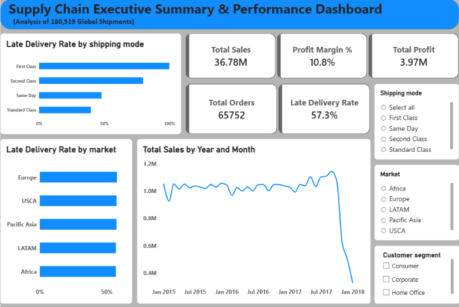
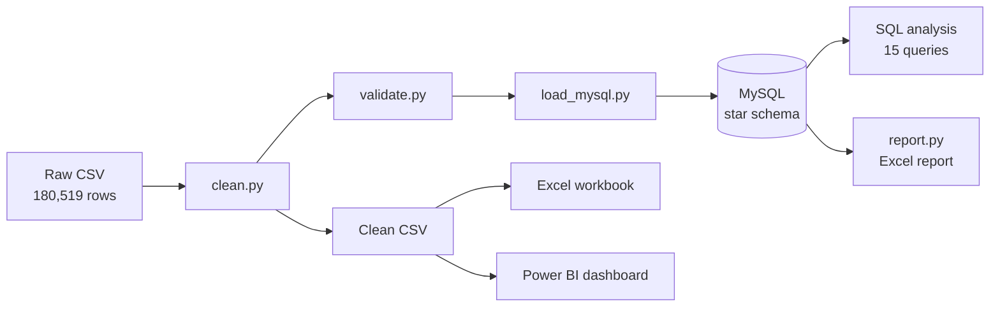
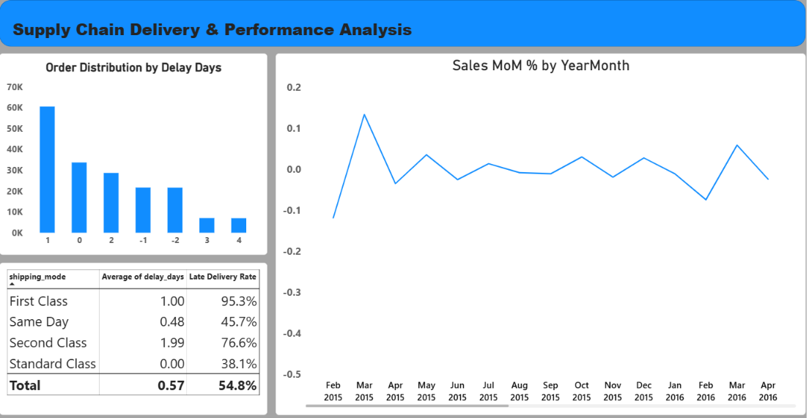
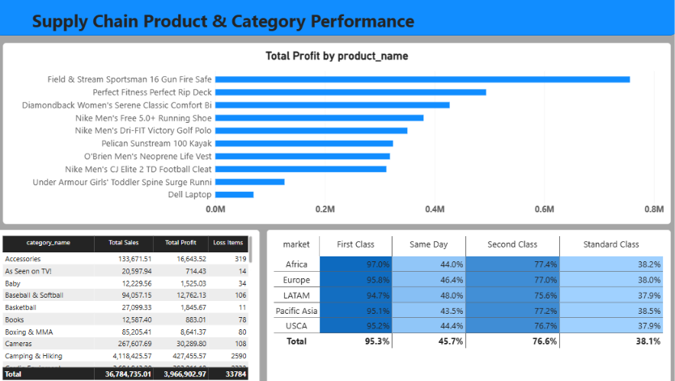

# SupplyChain IQ


An end-to-end analytics project on the DataCo Smart Supply Chain dataset from Kaggle. It finds where
deliveries run late, how sales and profit are spread, and automates the data flow with Python, MySQL,
Excel and Power BI. This is a personal portfolio project built on public data.

## Highlights

- 180,519 order items and 65,752 orders from 2015 to 2018, analyzed with Python, MySQL, Excel and Power BI.
- 57.29% of delivered items were late. All 26,513 delivered First Class items were late, against 39.77% for Standard Class.
- First Class promises 1 day and averages 2 days. Second Class promises 2 days and averages 3.99.
- One command (`python run_pipeline.py`) cleans, validates, loads and reports.



*Power BI executive summary. Two cards in this screenshot use different definitions from the SQL analysis
(see Notes and limitations): Total Orders counts order items, and Late Delivery Rate includes cancelled shipments.*

## Business questions

1. How many orders, how much sales and profit?
2. What share of deliveries is late?
3. Which shipping mode is late most often?
4. Does late delivery change by market?
5. Which products and categories lead in sales and profit?
6. Where are the loss-making items?
7. How do customer segments perform?
8. How do sales trend month by month?
9. How far apart are the promised and the actual shipping days?

## Dataset

[DataCo Smart Supply Chain for Big Data Analysis](https://www.kaggle.com/datasets/shashwatwork/dataco-smart-supply-chain-for-big-data-analysis) on Kaggle.
The raw Kaggle files are not included. Check the Kaggle page for the license terms.
The cleaned data is embedded in the Excel workbook and the Power BI file. Personal columns
(customer name, email, password and street) were removed during cleaning.

| Item | Value |
|---|---|
| Rows (one row is one order item) | 180,519 |
| Columns | 53 raw, 43 after cleaning |
| Orders | 65,752 |
| Customers | 20,652 |
| Products | 118 |
| Order dates | 2015-01-01 to 2018-01-31 |

## Pipeline



`python run_pipeline.py` runs the clean, validate, load and report steps in one command.

## Data model

One fact table and two dimension tables.

| Table | One row is | Rows |
|---|---|---|
| fact_order_items | one order item | 180,519 |
| dim_customer | one customer | 20,652 |
| dim_product | one product | 118 |

The fact table links to both dimensions through foreign keys on `customer_id` and `product_id`.

## Data preparation and checks

- Column names standardized (lowercase with underscores).
- Five duplicate columns were proven identical before being dropped. Eight personal or empty columns were removed.
- Dates converted from text to real dates, with zero invalid dates.
- New columns added: `delay_days`, `is_late`, `is_loss`.
- `validate.py` stops the pipeline if the order item id is not unique, a key column has nulls, sales are not positive, or the late flag is all zero.
- `load_mysql.py` checks that the MySQL row count equals the DataFrame row count.
- `sql/load_checks.sql` confirms the table counts and that no fact row is missing its customer or product.

## Key definitions

- **Late %** is late items divided by delivered items. Items with `Shipping canceled` are excluded.
- **Order level late** counts an order as late when any of its items is late.
- **Profit** is the `benefit_per_order` column. **Sales** is the amount before discount.
- **Total orders** is the number of distinct order ids, not the number of rows.

## Key findings

All numbers come from the SQL queries in `sql/02_analysis.sql` on this dataset.

| Finding | Number |
|---|---|
| Total sales, profit, margin | 36.78M, 3.97M, 10.78% |
| Delivered items and late items | 172,765 and 98,977 |
| Late delivery rate (item level, order level) | 57.29% and 57.31% |
| Late % by shipping mode | First Class 100%, Second Class 79.83%, Same Day 47.93%, Standard Class 39.77% |
| Late % by market | 56.84% to 57.69%, no large difference |
| Loss-making items | 33,784 (18.7% of items) |
| Cancelled shipping items | 7,754 (3,692 canceled orders and 4,062 suspected fraud orders) |
| Top 10 products | about 90% of total sales |

Promised days against actual days (delivered items):

| Shipping mode | Promised | Actual average |
|---|---|---|
| First Class | 1.00 | 2.00 |
| Second Class | 2.00 | 3.99 |
| Same Day | 0.00 | 0.48 |
| Standard Class | 4.00 | 3.99 |

First Class and Second Class promise fewer days than they deliver. The dataset does not contain the
cause (carrier, route or capacity), so no cause is claimed.

## Dashboards

Both read the cleaned CSV (`data/clean/dataco_clean.csv`).

**Power BI** (`powerbi/`) has 3 pages and 8 DAX measures (Total Sales, Total Profit, Profit Margin %,
Total Orders, Late Delivery Rate, Loss Items, Previous Month Sales, Sales MoM %) plus a Calendar table.




**Excel** (`excel/`) has a KPI sheet and five PivotTables (shipping mode, market, category, year, segment).

## Reconciliation across tools

| Metric | MySQL | Excel | Power BI |
|---|---|---|---|
| Total sales | 36,784,734.31 | 36,784,735.01 | 36,784,735.01 |
| Total profit | 3,966,902.97 | 3,966,902.97 | 3,966,902.97 |

The 0.70 difference in sales comes from rounding. MySQL stores each amount with two decimals
(`DECIMAL(12,2)`), while the CSV keeps longer decimals.

## Project structure

```
supplychain-iq/
    data/
        raw/            original Kaggle files (not uploaded)
        clean/          cleaned CSV (created by clean.py, not uploaded)
    excel/              Excel workbook with KPI sheet and PivotTables
    notebooks/          exploration and cleaning notebook
    powerbi/            Power BI file and dashboard screenshots
    python/
        config.py       paths and database login
        clean.py        cleans the raw CSV
        validate.py     data quality checks
        load_mysql.py   loads the three tables
        report.py       Excel report from SQL
        run_pipeline.py runs all steps
        eda.py          charts
    sql/
        00_basics.sql        SQL basics examples
        01_schema.sql        database and tables
        02_analysis.sql      15 analysis queries and a view
        03_practice.sql      practice queries
        load_checks.sql      checks after loading
    requirements.txt
    LICENSE
```

## How to run

Requirements: Python 3.10 or newer, MySQL 8 and MySQL Workbench.

```bash
git clone https://github.com/surajyadav011/supplychain-iq.git
cd supplychain-iq
pip install -r requirements.txt
```

1. Download the dataset from Kaggle and place `DataCoSupplyChainDataset.csv` in `data/raw/`.
2. Open `sql/01_schema.sql` in MySQL Workbench and run it once to create the tables.
3. Set the database password as an environment variable (PowerShell):

```powershell
$env:DB_PASSWORD = "your_mysql_password"
```

4. Run the pipeline:

```bash
cd python
python run_pipeline.py
```

This creates `data/clean/dataco_clean.csv`, loads the MySQL tables, and writes an Excel report to `reports/`.
Run the queries in `sql/02_analysis.sql` one at a time in MySQL Workbench.

## Before you use or share this project

- Replace `Your_Name` in the Author section below and in the `LICENSE` file with your own name.
- Never write a password in code. Use the `DB_PASSWORD` environment variable.
- Do not commit dataset files. Excel and Power BI files embed the dataset and can carry personal
  document properties (in Excel: File, Info, Check for Issues, Inspect Document).
- Use your GitHub noreply email in Git so your personal email is not public.

## Notes and limitations

- Monthly sales fall sharply after October 2017. Orders did not fall (1,723 in September 2017 and
  2,101 in October), but items per order dropped from 3.00 to about 1. This is a change in the data,
  not a business decline. Data for 2018 covers January only.
- Several products have a category that does not match the product name. Category results describe
  this dataset only.
- The Power BI Late Delivery Rate card is calculated over all items, including cancelled shipments
  (54.83%). The SQL analysis and the definitions above exclude cancelled shipments (57.29%).
- The Power BI Total Orders card counts order items (about 181K). Distinct orders are 65,752.
- The dataset is public and anonymized. Findings describe this dataset, not a real company, and the
  causes of late delivery are not in the data.
- The pipeline is a local script. It reloads all data on every run and has no scheduler or alerts.

## Possible next steps

These are ideas and are not implemented: logging and alerts for the pipeline, loading only new rows,
a model that predicts late deliveries, and an Excel dashboard screenshot.

## Skills demonstrated

Python (pandas, SQLAlchemy), data cleaning and validation, MySQL (star schema, JOINs, CTEs, window
functions), Excel PivotTables, Power BI (DAX measures, Calendar table), KPI definition and
reconciliation, pipeline automation, Git and GitHub.

## Author

Your_Name, GitHub: [@surajyadav011](https://github.com/surajyadav011)

## License

Code is released under the MIT License. See the LICENSE file.
